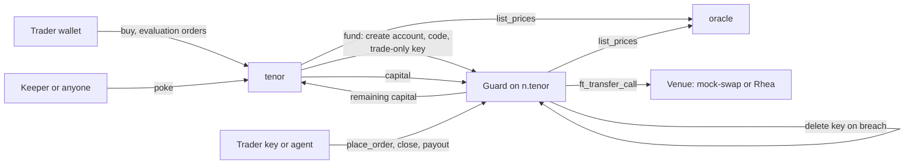

# Tenor

Tenor is a retail prop-trading firm whose rules run as NEAR contracts. A trader pays once for an
evaluation, and if they hit the target inside the loss limits they trade real capital and keep 80%
of the profit. The firm cannot hold trades in-house, cannot change a verdict, and cannot move a
funded account's money.

Tracks: `security` (primary), `defi`. Other submission: none.

## Status

| Part | State |
|---|---|
| Contracts, rules, demos, attack demo | Run end to end on NEAR testnet and on a local sandbox |
| Money movement | `npm run demo:money` checks every balance to the micro-USDC across 15 steps, on testnet and sandbox. The latest run is at `/proof` |
| Full web journey (buy, pass, fund, swap, payout, end account) | Driven through the browser UI on a local sandbox |
| 1Click checkout and payout quotes | Live mainnet quotes, dry-run only |
| Testnet deployment | Live. Ids below |
| Web app | Live at https://tenor-hazel-theta.vercel.app |
| Wallet login on testnet | Built, not yet tested with a real wallet |
| Mainnet swaps through Rhea | Adapter written and unit tested, **never run on mainnet** |
| Chain Signatures, LP shares | Not built |

## Problem

Most prop firms run a B-book: trades stay in-house and the firm earns when traders lose. The trader
has to trust that fills, breaches and payouts are honest, and that the firm can pay at all.

## How NEAR enforces each promise

| Promise | Mechanism | Code |
|---|---|---|
| No B-book: every funded trade is a real swap | Each funded account is its own sub-account running a Guard. It swaps with `ft_transfer_call` to the venue, then rebuilds its book from token balances. Tenor adds no full-access key. | [`fund`](contracts/tenor/src/lib.rs), [`swap`](contracts/guard/src/lib.rs), [`on_balances`](contracts/guard/src/lib.rs) |
| Trade-only keys | The trader holds a function-call key limited to `place_order`, `close_position` and `request_payout`. Such keys can't attach deposits, transfer NEAR or add keys. A breach deletes the key in the same receipt. | [`TRADER_METHODS`, `breach`](contracts/guard/src/lib.rs) |
| Every loss is pre-funded | `fund` panics unless reserve >= (live max loss + new max loss) x 1.2. After the fee, the only income is 20% of realised profit. | [`reserve_covers`](crates/tenor-rules/src/lib.rs), [`fund`](contracts/tenor/src/lib.rs) |
| One rulebook | Evaluations and funded accounts call the same `evaluate`, in a crate with no blockchain dependency. | [`evaluate`](crates/tenor-rules/src/lib.rs) |
| Unstoppable rules | `poke` is permissionless. Anyone can apply rollover, stops, breaches and liquidation. | [`poke`](contracts/tenor/src/lib.rs) |

Rules run in a fixed order: TP/SL, UTC rollover, breach, pass. If a price is older than 60 seconds
there are no fills and no breaches, so bad data can't end an account.

## Try it in 5 minutes (sandbox, no funds, no keys, no Rust)

Needs Node 22+ on Linux, macOS, or Windows with WSL Ubuntu. Compiled contracts are in `wasm/`.

1. Run `npm install`.
2. In a second terminal, run `npm run sandbox`. **See:** `Sandbox RPC: http://127.0.0.1:3030`.
3. Run `npm run deploy -- --network sandbox`. **See:** `Deployed to sandbox.`
4. Run `npm run demo:eval -- --network sandbox`. **See:** `status: Passed` and `PASS`. A challenge is bought, traded and passed entirely onchain.
5. Run `npm run demo:breach -- --network sandbox`. **See:**
   - `keys on guard: 1` with a `FunctionCall` permission after funding
   - `status: Breached (daily_loss)` after a 4% fall
   - `keys on guard: 0`, then `rejected by the protocol`
   - `capital returned` and `PASS`
6. Run `npm run attack-demo -- --network sandbox`. **See:** five `PASS` lines in the summary.
7. Run `npm run demo:oneclick`. **See:** real quotes in both directions and `deposit address: none`.

The demos use a separate stack whose oracle accepts scripted prices, because a real +10% move can't
be waited for. Its price is the only thing scripted: the contracts are the same.

### Web app on the sandbox

This needs no wallet and no Clerk keys. The page refreshes oracle prices by itself while a trading screen is open.

1. Keep the sandbox running. Run `NEXT_PUBLIC_NETWORK=sandbox npm run dev`, then open http://localhost:3000/dashboard.
2. Click **Create sandbox account** (bottom right). **See:** your account id there.
3. Click **Demo mode: off** in the top bar. **See:** it changes to **Demo mode: on**.
4. Open **Buy Challenge**, pick **5K**, **Add to cart**, **Checkout**, **Get test USDC**, tick the box, **Pay $36.00**. **See:** the evaluation on your dashboard.
5. Open it, click **MAX**, **Buy BTC**, then **BTC +11%** and **Apply rules**. **See:** status `Passed`.
6. Click **Fund account**. **See:** a funded page with exactly one function-call key listed.
7. Click **MAX**, **Buy BTC**, **BTC +2%**, then **Sell / Close** and **Close BTC**. **See:** `Your 80%` above zero.
8. Enter your own account as the recipient and click **Request payout**. **See:** `Paid so far` equals 80% of the profit.
9. Click **End account**. **See:** status `Settled` and `No keys remain`.
10. Open `/transparency` for the reserve and every funded account, and `/proof` for the recorded money proof.

## Prove where the money goes

`npm run demo:money` runs a winning trader and a breaching trader through the contracts. Each step reads every party's token balance and the contract's books from the chain before and after, and compares the change with an amount calculated separately by `packages/rules-ts` from the oracle price. One micro-USDC off fails the run.

| Step | Exact movement checked |
|---|---|
| Buy a challenge | Trader's fee moves to Tenor and is booked to the reserve |
| Pass the evaluation | Nothing moves: evaluations are paper accounts |
| `fund` | $5,000 moves from the vault to a new Guard account |
| Swap | All capital moves to the venue, and the BTC received matches the rules exactly |
| Payout | Profit splits 80/20 to the trader and treasury. Capital stays in the Guard |
| Trade-only key pays a stranger | Refused. Nothing moves |
| End the account | Profit splits 80/20 and all capital returns to the vault |
| Breach | The trader gets nothing, the key is deleted, and the reserve covers the loss |

After every step, Tenor's real token balance must match its reserve and vault books, the Guard's book must match its token balance, and the sum of all changes must equal what the token minted. Run it with `--network sandbox`, or on testnet after `npm run faucet`. It writes `deployments/money-proof.<network>.json`, which `/proof` displays.

## Testnet

The contracts are deployed, so these run against the live demo stack.

1. Run `npm run faucet`. **See:** a new account with 10 NEAR, saved to `.env`.
2. Run `npm run demo:money -- --network testnet`. **See:** a `PASS` line, plus an explorer link per transaction.
3. Run `npm run demo:eval -- --network testnet`, `npm run demo:breach -- --network testnet` and `npm run attack-demo -- --network testnet`. Each needs a freshly funded sponsor.

On the hosted site, the **Demo mode** switch uses these same contracts with prices anyone can set, so a pass or breach takes seconds instead of a real 10% market move. With it off, the site trades against live prices.

The site keeps prices fresh with `/api/keeper`, called while a trading screen is open. It signs with keys that can call only `push_prices` on one oracle. To set them up, run `npm run keeper:keys -- --network testnet`, then copy the `KEEPER_` values from `apps/web/.env.local` into the host's environment variables.

To deploy your own: put a funded account in `.env` and run `npm run deploy -- --network testnet`.
That needs about 27 NEAR with `--guard bytes`, where the factory deploys the Guard code directly. The default, a global contract, burns about 25 more when published.

## Dry-run 1Click

`npm run demo:oneclick`, or the *Pay from any chain* panel on `/challenges` and the payout panel on
a funded account. Quotes use `dry: true`, so 1Click returns prices and no deposit address. Live
quotes are refused unless `ONECLICK_ALLOW_LIVE=1`. Each panel shows where the funds sit at every stop, and rejects a quote whose total cost is over your limit. *Track a swap* follows a real deposit address through every 1Click status, including `INCOMPLETE_DEPOSIT`, `REFUNDED` and `FAILED`. No key is needed; without one 1Click adds 0.25%.

Checkout delivers to the user's NEAR account and the UI then calls `ft_transfer_call`. 1Click's
`customRecipientMsg` could deliver straight to the contract, but its docs mark it highly
experimental and say funds can be lost. For payouts, `request_payout(deposit_address)` sends only
the trader's own share there, so a bad address can only hurt the trader.

## Attack demo

An agent holding only the Guard's function-call key obeys a prompt injection. It runs with a
scripted worst-case mock by default; `--llm` with `ANTHROPIC_API_KEY` uses a real model.
Run `npm run attack-demo -- --network testnet`, or `--network sandbox` for no funds.

| Attack | Stopped by | Evidence in the log |
|---|---|---|
| Transfer NEAR to an attacker | NEAR protocol | `Access key requires full access` |
| Add a full-access key | NEAR protocol | Same error, still one key on the account |
| Pay profit to a known-bad address | Counterparty check | `BLOCK`, nothing signed |
| Skip the check and sign the payout anyway | Guard | `Recipient is not approved by the trader's wallet`, attacker balance 0 |
| Pay a brand-new unknown address | Human, asked on warn | `WARN`, human declined, nothing signed |
| Order above the notional cap | Guard | `order_rejected`, reason `notional_cap` |
| Trade until breach | Guard | Status `Breached`, zero keys left |
| Trade after the breach | NEAR protocol | `Access key ... does not exist` |

As a control, the same key then pays the trader's own account, split 80/20.

## What the agent's key can and can't do

It is a function-call access key whose receiver is the Guard account, limited to `place_order`,
`close_position` and `request_payout`. Every call is signed as the Guard.

**The protocol guarantees** it cannot transfer NEAR, add or delete keys, deploy code, attach a
deposit, or call any other contract or method.

**The Guard guarantees** it stays inside the loss limits and position caps, can't fill more than 1%
worse than the oracle, trades only through the configured pools, and can only pay the trader's
account or addresses the trader's own wallet approved. Approval needs a 1 yoctoNEAR deposit from the
trader's account, which this key can't provide or sign for.

**It can still** lose money inside the limits, up to the breach, by trading badly or churning fees.
It can also spend the Guard's NEAR on gas, up to its allowance, and trigger a payout to an address
that is already approved.

## Counterparty check

Before paying anyone, the agent calls [`checkCounterparty`](packages/counterparty/src/index.js) and
gets `allow`, `warn` or `block` with reasons. [`agent/guarded.mjs`](agent/guarded.mjs) refuses to
sign on `block` and asks a human on `warn`. The same check is on the payout form and at `/safety`.

| Signal | Source | Effect |
|---|---|---|
| Shared blocklist | `status` on the [blocklist contract](contracts/blocklist/src/lib.rs) | 1 report warns. 2 reporters or a confirmation blocks |
| Account exists | RPC `view_account` | Missing named account blocks. Unused implicit address warns |
| Is a contract | RPC `code_hash` | Warns |
| Code changed recently | Archival RPC `view_account` 1 and 7 days back | Under 24h blocks, under 7 days warns |
| Account age | FastNear Transactions API, oldest transaction | Under 7 days warns |
| Activity | FastNear `txs_count` | Fewer than 3 warns |
| Past interactions | Transactions in both accounts' recent history | Shown as context |

If a source can't be read the answer is `warn`, never a silent pass.

The check runs on the agent's side, so a fully compromised agent can skip it. That is why the
recipient rule is also enforced in the Guard. Blocklist reports cost 0.01 NEAR, which limits spam but
doesn't stop someone paying for two accounts to flag a target.

## Deployed contracts

Testnet ids are also in [`deployments/testnet.json`](deployments/testnet.json).

| Contract | Account |
|---|---|
| Tenor (live prices) | [tenor.testnet](https://testnet.nearblocks.io/address/tenor.testnet) |
| Tenor (demo stack, scripted prices) | [demo.tenor.testnet](https://testnet.nearblocks.io/address/demo.tenor.testnet) |
| Oracle | [oracle.tenor.testnet](https://testnet.nearblocks.io/address/oracle.tenor.testnet), [demo-oracle.tenor.testnet](https://testnet.nearblocks.io/address/demo-oracle.tenor.testnet) |
| Mock swap venue | [swap.tenor.testnet](https://testnet.nearblocks.io/address/swap.tenor.testnet), [demo-swap.tenor.testnet](https://testnet.nearblocks.io/address/demo-swap.tenor.testnet) |
| Shared blocklist | [blocklist.tenor.testnet](https://testnet.nearblocks.io/address/blocklist.tenor.testnet) |
| Mock USDC | [usdc.tenor.testnet](https://testnet.nearblocks.io/address/usdc.tenor.testnet) |
| Mock market tokens | `btc`, `eth`, `sol` and `near` `.tenor.testnet` |

A funded Guard from the demo run, with its trader key deleted: [1.demo.tenor.testnet](https://testnet.nearblocks.io/address/1.demo.tenor.testnet). The transaction that breached it: [38t6cptm…](https://testnet.nearblocks.io/txns/38t6cptmVT2rNUppo13ubnUaVDspUPUtfsnaUKcFjRz8).

External dependencies, checked against the live chain or docs:

| Contract | Network | Use |
|---|---|---|
| `v2.ref-finance.near` | mainnet | Rhea swap venue |
| `17208628f84f5d6ad33f0da3bbbeb27ffcb398eac501a31bd6ad2011e36133a1` | mainnet | Native USDC |
| `https://1click.chaindefuser.com` | mainnet | NEAR Intents 1Click API |

## Architecture

**Why this venue:** `execute_intents` on `intents.near` only takes signed payloads, and a swap needs
a solver's offsetting signature obtained off-chain. A contract with no key can't do that without an
off-chain signer, so swaps go through Rhea, where the Guard's own `ft_transfer_call` is enough and
the DEX enforces `min_amount_out`. Intents handles the cross-chain edges.

The Guard also enforces a 1% slippage floor against the oracle, whatever the trader asks for, so a
trader can't route capital through a pool they control at a bad price.

## Trust assumptions

- **Price oracle.** Pyth's Hermes has required a paid API key since 2026-08-26, and `pyth-oracle.testnet` has been stale since June 2026. The testnet stack therefore reads `tenor-oracle`, which has Pyth's interface and is pushed by one keeper account using 1Click's public prices with a fixed 0.03% spread. **That keeper could post false prices.** A Pyth deployment needs only a different oracle account id.
- **OutLayer's oracle is not usable today.** `price-oracle.testnet` has none of Pyth's methods and no registered oracles.
- **Owner powers.** The owner can change pass rates (new sales only) and the oracle for evaluations and future Guards. A live Guard's oracle and rules are fixed at creation.
- **Contract upgrades.** `tenor` itself has an owner key while in development. Guards have no full-access key. On testnet the factory deploys Guard code it stores, because a global contract costs more testnet NEAR. The owner could change that code for future Guards but not existing ones, and each account’s code hash is public.
- **Mock assets.** On testnet, USDC and the market tokens are mocks with an open faucet, and `mock-swap` mints its output.
- **Keeper liveness.** A breach is only applied when someone calls `poke` or trades, so a dip between calls can go unseen. The web app refreshes prices only while a trading screen is open, so with nobody watching, prices go stale and nothing fills until someone returns.

## Limitations

- Spot, long or flat only. BTC, ETH, SOL and NEAR on testnet. Every buy is its own trade with its own entry and TP/SL, up to 20 open per account. Position caps and breach checks count all trades in a market together.
- Funded accounts opened before independent trades were added keep their original behaviour, because a Guard's code is fixed at creation.
- On mainnet, Rhea only has deep USDC liquidity for NEAR (pool 4512), so real swaps would be NEAR only.
- With a 60-second price limit, a trader can act on information newer than the oracle. The spread and fee reduce this but don't remove it.
- Candle charts stream live trades from Coinbase's public feed, for context. Fills use the onchain oracle, so there is no order book, and the two prices can differ slightly.
- Checkout from another chain is a dry-run quote only. Card payment, email login and coupons don't exist.
- Breach records link to the account and block rather than the exact transaction.
- Trade history lists transactions from a public indexer. An order that reached the contract and was rejected there still shows as confirmed.
- Popup-free evaluation trading needs a wallet that supports testnet and function-call keys. Others prompt on each order.
- The trader key for a funded account lives in that browser's storage.
- Not audited.

## Tests

- `npm test`: 32 tests, covering the shared vectors against the TypeScript rules and the counterparty policy.
- `cargo test --workspace`: 119 tests covering the fee table, rule ordering, shared vectors, contract panic paths and failed payout or settlement legs.
- `scripts/build-wasm.sh` then `npm run wasm:optimize`: rebuilds and shrinks `wasm/`. The build needs `RUSTFLAGS='--cfg near'`, which the script sets.

## Prior work

A previous version of this concept exists on Arc (Circle's L1) at github.com/vishnudevs1/tenor. No
code was copied from it. This repository is a from-scratch rebuild for NEAR, started during the
hackathon window, and only this work should be judged.

## Libraries used

- Rust: `near-sdk`, `near-contract-standards`
- JS: `near-api-js`, `@hot-labs/near-connect`, `function-call-key-plugin`, `@clerk/nextjs`, `next`, `react`, `tailwindcss`, `three`, `motion`, `lightweight-charts`, `geist`, `dotenv`, `bs58`
- Tools: `near-sandbox`, `binaryen`
- Data: FastNear RPC and Transactions API, Coinbase Exchange market data
- Reference only: `@ref-finance/ref-sdk` (swap message format), `near/intents` (Verifier source)
- AI-generated code: parts of this repository were written with an AI coding assistant, as allowed by HACKATHON.md Q-005.

MIT licensed.
